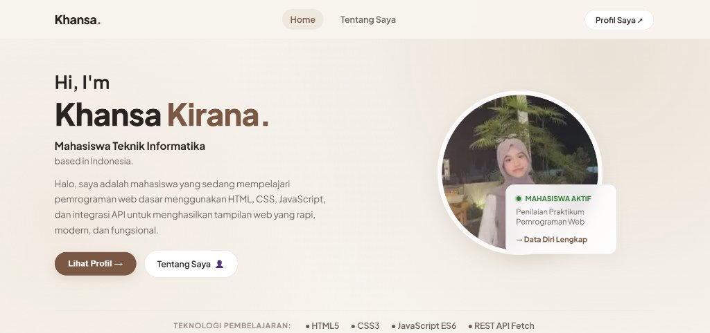
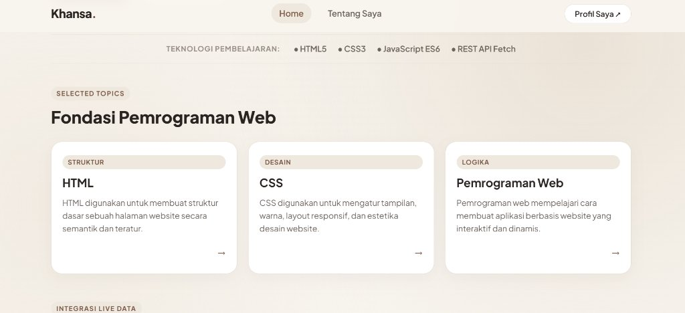
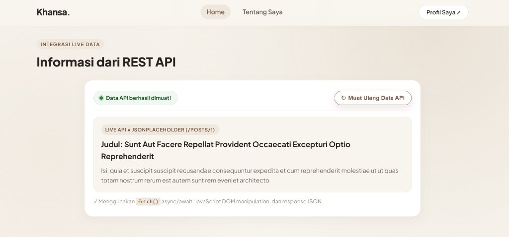
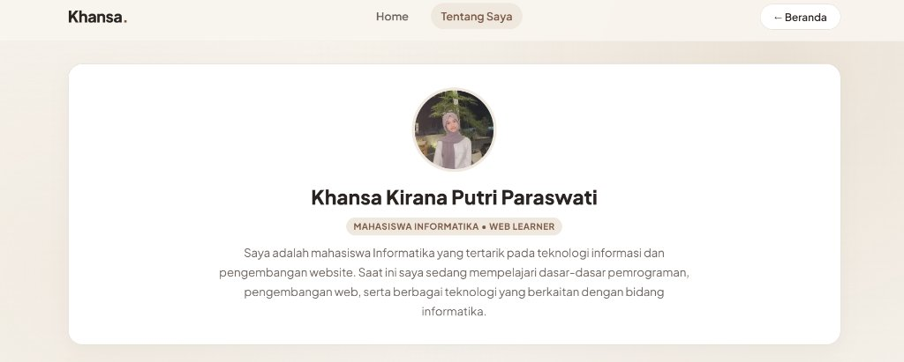
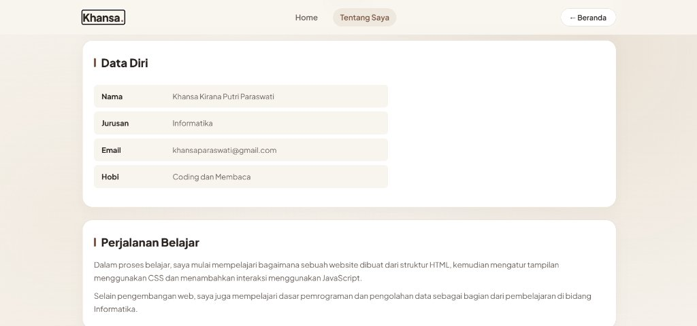
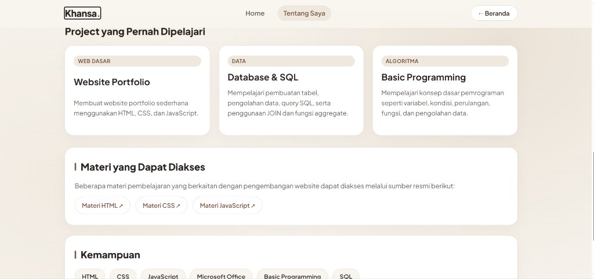

# 🌐 Tugas Praktikum Pemrograman Web
### Penerapan HTML, CSS, JavaScript, dan Integrasi Public REST API

Repository ini dibuat untuk memenuhi tugas mata kuliah **Pemrograman Web** yang diampu oleh **Bu Bela**. Website ini merupakan portofolio interaktif dan edukatif yang mengimplementasikan fondasi web modern serta integrasi data dinamis secara *real-time*.

---

## 👤 Identitas Mahasiswa

* **Nama:** Khansa Kirana Putri Paraswati  
* **Program Studi:** S1 Teknik Informatika  
* **Mata Kuliah:** Pemrograman Web  
* **Dosen Pengampu:** Bu Bela  
* **Tautan Repository:** [github.com/khansakirana/Tugas-Pemweb-Bu-Bela](https://github.com/khansakirana/Tugas-Pemweb-Bu-Bela)

---

## 🛠️ Fitur & Penerapan Teknologi

Website ini dibangun tanpa menggunakan framework (*vanilla web technologies*) untuk mendalami konsep inti rekayasa web:

### 1. HTML5 (Struktur Semantik & Multi-Halaman)
* **Tag Semantik Modern:** Menggunakan `<header>`, `<nav>`, `<main>`, `<section>`, `<footer>`, `<article>`, serta heading bertingkat (`h1`–`h4`).
* **Navigasi Multi-Halaman:** 
  * `index.html`: Beranda, perkenalan diri, ringkasan materi dasar, dan widget integrasi API.
  * `about.html`: Profil lengkap, tabel data diri, riwayat perjalanan belajar, daftar project, tautan referensi belajar (MDN Web Docs), dan daftar keahlian.
* **Tabel & List:** Penyajian biodata dengan tag `<table>` yang rapi serta daftar keahlian menggunakan `<ul>` dan `<li>`.

### 2. CSS3 (Desain Modern, Estetik & Responsif)
* **Tema Warna:** Palet minimalis bernuansa *Warm Brown & Beige* yang didefinisikan secara modular menggunakan CSS Custom Properties (`:root`).
* **Tata Letak Modern:** Mengombinasikan **Flexbox** (pada navigasi, header, dan footer) serta **CSS Grid** responsif (`repeat(auto-fit, minmax(...))`) pada kartu materi dan project.
* **Desain Responsif (Mobile-Friendly):** Menggunakan *media queries* (`max-width: 900px` dan `max-width: 600px`) sehingga website nyaman diakses melalui laptop, tablet, maupun smartphone.
* **Animasi & Interaksi:** Efek transisi *hover* pada tombol dan kartu materi, serta animasi melayang halus (*floating badge animation*) pada hero section.

### 3. JavaScript ES6 (Interaktivitas & Logika Klien)
* **Manipulasi DOM:** Mengubah konten teks (`textContent`), atribut, dan elemen HTML secara dinamis.
* **Event Handling:** Event listener `DOMContentLoaded` untuk eksekusi fungsi otomatis saat halaman selesai dimuat.
* **Navigasi Berwaktu:** Fungsi `bukaProfil()` yang menampilkan indikator pemuatan (*loading indicator*) interaktif sebelum berpindah halaman menggunakan `setTimeout()`.

### 4. Integrasi Public REST API (Data Dinamis Real-Time)
* **Endpoint Publik:** Menggunakan REST API dari [JSONPlaceholder](https://jsonplaceholder.typicode.com/posts/1).
* **Asynchronous JavaScript:** Menggunakan sintaks modern `fetch()` dengan `async/await` untuk pengambilan data tanpa *reload* halaman.
* **Validasi & Error Handling:** Validasi status respons HTTP (`response.ok`) dan penanganan kendala jaringan menggunakan blok `try...catch`.
* **Fitur Muat Ulang (Refresh):** Tombol interaktif untuk memuat ulang data API secara langsung disertai visualisasi status (*loading*, *success*, atau *error*).

---

## 📸 Dokumentasi Tampilan Website (Screenshots)

Berikut adalah dokumentasi tangkapan layar antarmuka website yang telah diimplementasikan:

### 1. Halaman Beranda (`index.html`)

#### A. Hero Section & Profil Singkat
Tampilan awal website dengan ucapan selamat datang, foto profil beranimasi badge aktif, deskripsi, dan tombol navigasi interaktif.


#### B. Fondasi Pemrograman Web (Materi Card)
Bagian kartu materi interaktif yang menjelaskan pilar HTML, CSS, dan Pemrograman Web dengan tata letak Grid.


#### C. Integrasi Data Real-Time REST API
Komponen live data yang menampilkan judul dan isi postingan dari REST API JSONPlaceholder dengan indikator status dan tombol *Muat Ulang Data API*.


---

### 2. Halaman Tentang Saya (`about.html`)

#### A. Profil Utama
Kartu profil mahasiswa dengan avatar lingkaran dan deskripsi fokus pembelajaran di bidang Informatika.


#### B. Data Diri & Perjalanan Belajar
Penyajian data diri lengkap dalam format tabel bersih serta narasi tahapan proses belajar rekayasa web.


#### C. Project, Referensi Materi & Daftar Kemampuan
Daftar proyek perkuliahan yang pernah dipelajari, tombol tautan resmi dokumentasi MDN, dan deretan *skill badges*.


---

## 📁 Struktur Direktori Proyek

```text
web-bu-bela/
│
├── index.html                  # Halaman Beranda & Integrasi API
├── about.html                  # Halaman Profil Lengkap & Data Diri
├── style.css                   # File Utama CSS (Theme, Layout, Responsive)
├── script.js                   # Logika Interaktif & Fetch REST API
├── README.md                   # Dokumentasi Resmi Proyek
│
└── screenshots/                # Dokumentasi Tangkapan Layar Tampilan
    ├── 01-home-hero.jpg
    ├── 02-home-materi.jpg
    ├── 03-home-api.jpg
    ├── 04-about-profil.jpg
    ├── 05-about-data-diri.jpg
    └── 06-about-project-skills.jpg
```

---

## 🚀 Cara Menjalankan Proyek Secara Lokal

1. **Clone repository ini:**
   ```bash
   git clone https://github.com/khansakirana/Tugas-Pemweb-Bu-Bela.git
   ```
2. **Masuk ke direktori proyek:**
   ```bash
   cd Tugas-Pemweb-Bu-Bela
   ```
3. **Buka file `index.html`:**
   * Cukup klik dua kali pada file `index.html` untuk membuka di browser apa pun (Chrome, Edge, Firefox), **atau**
   * Gunakan ekstensi *Live Server* pada Visual Studio Code untuk pengalaman peninjauan lokal yang optimal.

> *Pastikan perangkat terhubung ke internet saat membuka website agar data dari REST API dan font Google dapat dimuat dengan sempurna.*

---

